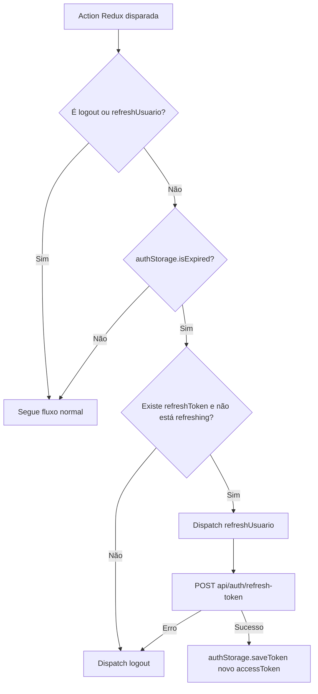
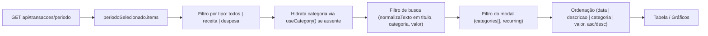

# Mapeamento de Fluxos Existentes (`docs/FLOWS.md`)

Este documento detalha os fluxos reais implementados no **FinControl** (`fin`), indicando os arquivos, hooks, slices, contextos e endpoints envolvidos em cada jornada.

---

## 1. Fluxo de Autenticação, Cold Start e Refresh Token

### 1.1 Entrada e Cold Start (`/auth`)
1. Ao acessar `/`, o roteador redireciona para `/auth` ([`src/routes/index.tsx`](../src/routes/index.tsx)).
2. [`AuthPage`](../src/pages/AuthPage.tsx) executa `useHealthApi()` no `useEffect` inicial para acordar as 3 APIs externas (`api/auth/health`, `email/health` com `mode: "no-cors"` e `api/transacoes/health`).
3. [`AuthPage`](../src/pages/AuthPage.tsx) lê `email` e `token` dos query params (`useSearchParams`). Se ambos existirem, [`Auth`](../src/components/Auth/index.tsx) abre diretamente a tela `"Reset"` (`FormReset`). Caso contrário, exibe `"Login"` com alternância interna para `"Registrar"` e `"Forgot"`.

### 1.2 Login, Registro, Visitante e Recuperação
O hook [`useAuth`](../src/Hooks/useAuth.ts) orquestra os dispatches para [`authSlice`](../src/Store/reducers/auth.ts):
- **Login (`logar`)** e **Visitante (`loginTeste`)**: enviam `{ email, password, system: systemName }` para `POST api/auth/login` (`apiAuth`). Em caso de sucesso, `authStorage.save(token)` persiste `token`, `refreshToken`, `claims`, `user`, `userId` e `expiresIn` no `localStorage`, e o usuário é redirecionado para `/dashboard`.
- **Registro (`registrar`)**: envia `{ ...data, system: systemName, profile: "fin_usuario" }` para `POST api/auth/registrar`.
- **Esqueci a senha (`recoverToken`)**: envia `{ email }` para `POST api/auth/forgot-password`.
- **Redefinir senha (`redefinirSenha`)**: envia `ResetPassFormData` para `POST api/auth/reset-pass`.

### 1.3 Hidratação e Refresh Automático (`authMiddleware`)
Na inicialização da Store, `authStorage.hydrate()` ([`src/Services/authStorage.ts`](../src/Services/authStorage.ts)) verifica se `expiresIn` já venceu e se `user` e `userId` existem no `localStorage`.

Durante o uso da aplicação, **toda action Redux** passa pelo [`authMiddleware`](../src/Store/middleware/authMiddleware.ts):

> **Atenção:** `authMiddleware.ts` envia `system: "fin"` hardcoded no payload do refresh, e `authStorage.clear()` no `logout` remove `token`, `user` e `expiresIn` (sem limpar `refreshToken`).

---

## 2. Roteamento, Layout e Bootstrap de Dados

1. **Proteção de Rotas:** [`PrivateRoute`](../src/routes/PrivateRoutes.tsx) consulta `useAuth().isAuthenticated`. Se `false`, redireciona para `/auth`.
2. **Rotas Privadas** (todas dentro de [`DefaultLayout`](../src/Layouts/DefaultLayout/index.tsx)):
   - `/dashboard` → [`MainPage`](../src/pages/MainPage.tsx) (`ContainerCategories` + `Dashboards` com `GraficoBarras`, `GraficoRosca`, `GraficoLinha`).
   - `/transacoes` → [`TransacaoPage`](../src/pages/TransacaoPage.tsx) (`ContainerCategories` no desktop + `Transacoes`).
   - `/categorias` → [`CategoriaPage`](../src/pages/CategoriaPage.tsx) (`Tabela type="categorias"`).
   - `/relatorios` → [`ReportsPage`](../src/pages/ReportsPage.tsx) (placeholder atual, visível na Sidebar apenas quando `!isMobile`).
   - `*` → redireciona para `/auth`.
3. **Bootstrap Automático no `DefaultLayout`:**
   Assim que o layout monta, 3 `useEffect` verificam os status no Redux e disparam buscas quando `"idle"`:
   - `statusPeriodo === "idle"` → `aplicarPeriodo(subtraiMeses(ultimoDiaMesAtual(), 1), ultimoDiaMesAtual())`
   - `statusComparativo === "idle"` → `aplicarPeriodoComparativo(3)` (últimos 3 meses)
   - `status === "idle"` (categorias) → `buscaCategorias()`

---

## 3. Fluxo de Transações

Gerenciado por [`transactionsSlice`](../src/Store/reducers/transactions.ts) + hook [`useTransactions`](../src/Hooks/useTransactions.ts).

### Operações e Efeitos no Estado
- **Criar (`createTransaction` → `POST api/transacoes/novo`):** envia `CreateTransactionRequest` (contrato em inglês: `type`, `description`, `amount`, `categoryId`, `transactionDate`, `isRecurring`, `parcelas`), recebe `TransacaoDTO` (`Transacao`), adiciona o item em `periodoSelecionado.items` e atualiza `getSaldoTotal` localmente (`+valor` se `TransactionType.Renda`, `-valor` se `Despesa`).
- **Atualizar (`updateTransaction` → `PUT api/transacoes/:id`):** envia `Transacao` (`TransacaoDTO` em português) e substitui o item em `periodoSelecionado.items` (não recalcula `getSaldoTotal`).
- **Deletar (`deleteTransactions` → `DELETE api/transacoes/:id`):** remove o item de `periodoSelecionado.items` e reverte o impacto em `getSaldoTotal`.
- **Buscar por ID (`getTransacao` → `GET api/transacoes/:id`):** preenche `itemById.item` para edição em `EditTransaction`.
- **Saldo Total (`fetchSaldoTotal` → `GET api/transacoes/saldo`)** e **Comparativo (`fetchTransactionsPeriodoComparativo` → `GET api/transacoes/saldo-mes`)**.

> **Nota:** Ao trocar de usuário (novo `logarUsuario.fulfilled`), `transactionsSlice`, `categoriesSlice` e `usuarioSlice` resetam seus estados para `initialState`.

---

## 4. Fluxo de Categorias

Gerenciado por [`categoriesSlice`](../src/Store/reducers/categories.ts) + hook [`useCategory`](../src/Hooks/useCategory.ts).

- **Listagem (`getCategories` → `GET api/categories`):** separa automaticamente em `items.receita` (`type === TransactionType.Renda`) e `items.despesa` (`type === TransactionType.Despesa`).
- **Ícones e Cores (`getIcones` → `GET api/categories/icones`, `getCores` → `GET api/categories/cores`):** carregados sob demanda para seleção em formulários e hidratação via `Map` no `useCategory`.
- **CRUD:**
  - Criar (`postCategories` → `POST api/categories`): insere na lista `receita` ou `despesa` conforme `type === 1`.
  - Buscar por ID (`getCategorieById` → `GET api/categories/:id`): usado para edição em `EditCategory`.
  - Atualizar (`updateCategoria` → `PUT api/categories/atualizar/:id`).
  - Deletar (`deleteCategories` → `DELETE api/categories/:id`).

---

## 5. Fluxo de Modais Globais e Tema

### 5.1 Modais (`FormNewContext`)
- [`FormNewProvider`](../src/contexts/FormNew/FormNewProvider.tsx) mantém `isOpenModal` com os tipos `"receita" | "despesa" | "categoria" | "editCategoria" | "editTransacao" | null`.
- O `<Modal>` é montado uma única vez em [`DefaultLayout`](../src/Layouts/DefaultLayout/index.tsx) e renderiza [`FormNew`](../src/components/FormNew/index.tsx).
- `FormNew` centraliza a exibição de `Feedback` (erro/sucesso) e `Loader` observando os estados de `useTransactions()` e `useCategory()`.

### 5.2 Tema (Dark / Light)
- [`themeSlice`](../src/Store/reducers/theme.ts) inicializa `dark` a partir de `localStorage.getItem("theme") == "dark"` e alterna via `toggleTheme`.
- [`App.tsx`](../src/App.tsx) injeta `darkTheme` ou `lightTheme` ([`src/styles/theme.ts`](../src/styles/theme.ts)) no `ThemeProvider` do `styled-components`.

---

## 6. Mapa Consolidado de Endpoints

| Serviço | Método & Rota | Thunk / Hook |
| :--- | :--- | :--- |
| `apiAuth` | `GET api/auth/health` | `useHealthApi` |
| `apiAuth` | `GET api/auth/wake-up` | `wake` (`auth.ts`) |
| `apiAuth` | `POST api/auth/login` | `logarUsuario` |
| `apiAuth` | `POST api/auth/registrar` | `registrarUsuario` |
| `apiAuth` | `POST api/auth/forgot-password` | `emitirRecoveryToken` |
| `apiAuth` | `POST api/auth/reset-pass` | `resetarSenha` |
| `apiAuth` | `POST api/auth/refresh-token` | `refreshUsuario` |
| `api` | `GET api/transacoes/health` | `useHealthApi` |
| `api` | `GET api/transacoes/periodo` | `fetchTransactionsPeriod` |
| `api` | `GET api/transacoes/saldo` | `fetchSaldoTotal` |
| `api` | `GET api/transacoes/saldo-mes` | `fetchTransactionsPeriodoComparativo` |
| `api` | `GET api/transacoes/:id` | `getTransacao` |
| `api` | `POST api/transacoes/novo` | `createTransaction` |
| `api` | `PUT api/transacoes/:id` | `updateTransaction` |
| `api` | `DELETE api/transacoes/:id` | `deleteTransactions` |
| `api` | `GET api/categories` | `getCategories` |
| `api` | `GET api/categories/:id` | `getCategorieById` |
| `api` | `POST api/categories` | `postCategories` |
| `api` | `PUT api/categories/atualizar/:id` | `updateCategoria` |
| `api` | `DELETE api/categories/:id` | `deleteCategories` |
| `api` | `GET api/categories/icones` | `getIcones` |
| `api` | `GET api/categories/cores` | `getCores` |
| `api` | `GET api/usuarios` | `getUserData` |
| `apiEmail` | `GET /email/health` | `useHealthApi` |
