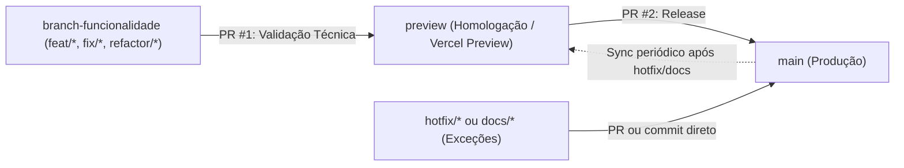

# Estratégia de Git, Branches, Commits e Pull Requests (`docs/GIT_WORKFLOW.md`)

Este guia define o fluxo padrão de versionamento do **FinControl** (`fin`) para manter `main` estável, validar entregas na branch intermediária `preview` e padronizar commits e PRs para humanos e agentes de IA.

---

## 1. Fluxo de Branches



### Regras do Fluxo
1. **Fluxo padrão (`branchFuncionalidade -> PR -> preview -> PR -> main`):**
   - Toda nova funcionalidade, correção não urgente ou refatoração nasce a partir de `preview` (ou `main` atualizada).
   - A branch é mergeada via **PR** na `preview` para validação integrada (build, lint e ambiente de preview da Vercel).
   - Quando o conjunto de alterações na `preview` estiver testado e pronto, abre-se um **PR de `preview` para `main`**.
2. **Exceções diretas na `main`:**
   - **Hotfixes críticos em produção**, **atualizações de documentação (`docs`)** ou **ajustes urgentes** podem ir direto para `main` (via `hotfix/* -> PR -> main` ou commit direto quando aplicável).
   - **Regra obrigatória pós-exceção:** após qualquer mudança direta na `main`, sincronizar `main` de volta em `preview` (`git checkout preview && git merge main && git push`) para evitar conflitos e drift entre ambientes.

---

## 2. Convenção de Nomenclatura de Branches

Formato: `<tipo>/<descricao-curta-kebab-case>`

| Prefixo | Quando usar | Base recomendada | Destino |
| :--- | :--- | :--- | :--- |
| `feat/` | Nova funcionalidade (ex: `feat/implementar-relatorios`) | `preview` | `preview` |
| `fix/` | Correção de bug não urgente (ex: `fix/ordenacao-tabela-valor`) | `preview` | `preview` |
| `refactor/` | Refatoração sem mudança de comportamento | `preview` | `preview` |
| `chore/` | Dependências, configs, build, lint | `preview` | `preview` |
| `hotfix/` | Correção crítica/urgente de produção | `main` | `main` |
| `docs/` | Documentação (`CONTEXT.md`, `README.md`, `docs/`) | `main` | `main` |

---

## 3. Padrão de Mensagens de Commit

Adotar **Conventional Commits** em português, no modo imperativo, sem ponto final no título:

```text
<tipo>(<escopo-opcional>): <descrição curta no imperativo>

[corpo opcional explicando o "porquê" e decisões relevantes]
```

### Tipos permitidos
- `feat`: nova funcionalidade para o usuário
- `fix`: correção de bug
- `hotfix`: correção urgente em produção
- `docs`: documentação (`CONTEXT.md`, `README.md`, `docs/*`)
- `refactor`: reestruturação de código sem alterar funcionalidade
- `style`: ajustes visuais/CSS (`styled-components`) sem alterar lógica
- `chore`: manutenção, dependências, configs (`vite`, `eslint`, `vercel`)
- `test`: criação ou ajuste de testes

### Escopos sugeridos para este projeto
`auth`, `transacoes`, `categorias`, `dashboard`, `relatorios`, `store`, `hooks`, `ui`, `theme`, `routes`, `docs`

### Exemplos
```text
feat(relatorios): adicionar gráficos de distribuição por categoria
fix(auth): usar systemName no payload de refresh token
hotfix(auth): corrigir endpoint de refresh token no middleware
docs(context): mapear fluxos existentes e criar CONTEXT.md ai-first
refactor(transacoes): extrair helpers de ordenação de useTransactions
```

---

## 4. Padrão de Título e Descrição de Pull Request (PR)

### 4.1 PR 1: Funcionalidade → `preview`
- **Título:** segue o mesmo padrão do commit principal:
  - `feat(escopo): descrição clara da entrega`
  - `fix(escopo): descrição clara da correção`
- **Descrição:** foco em **o que mudou, como testar e impacto técnico**:
  ```markdown
  ## 🎯 Objetivo
  Descreva brevemente o problema resolvido ou a funcionalidade implementada.

  ## 🛠️ O que foi alterado
  - Lista objetiva dos arquivos/camadas modificados (ex: `Store`, `Hooks`, `components`, `routes`).

  ## 🧪 Como validar na Preview
  1. Passo a passo para testar o fluxo no ambiente de preview.
  2. Cenários de erro ou borda verificados.

  ## ✅ Checklist
  - [ ] `npm run build` passou sem erros (`tsc -b && vite build`)
  - [ ] `npm run lint` passou sem erros
  - [ ] Testado em desktop e mobile (quando houver impacto de UI)
  - [ ] Variáveis de ambiente novas (se houver) documentadas no `CONTEXT.md`
  ```

### 4.2 PR 2: `preview` → `main` (Release)
- **Título:**
  - `release: <resumo das entregas>` (ex: `release: módulo de relatórios e ajustes de autenticação`)
- **Descrição:** foco em **visão consolidada de produção e verificação de regressão**:
  ```markdown
  ## 🚀 Resumo da Release (`preview` → `main`)
  Consolidação das alterações validadas em `preview`.

  ### ✨ Novidades & Melhorias
  - `feat(...)`: ...
  - `fix(...)`: ...

  ### ⚠️ Atenção / Pós-deploy
  - [ ] Variáveis de ambiente na Vercel conferidas (se houver novas)
  - [ ] Fluxo crítico validado em `preview` (Login, Dashboard, Transações, Categorias)
  ```

### 4.3 PR de Exceção: `hotfix/*` ou `docs/*` → `main`
- **Título:**
  - `hotfix(escopo): descrição curta da correção urgente`
  - `docs(escopo): descrição curta da documentação`
- **Descrição:** incluir o motivo da ida direta para `main` e confirmar o sync posterior com `preview`:
  ```markdown
  ## 🚨 Motivo da entrada direta na `main`
  Explicar a urgência (hotfix) ou natureza (docs).

  ## 🛠️ Alterações
  - ...

  ## 🔄 Pós-merge
  - [ ] Sincronizar `main` → `preview` após o merge
  ```
